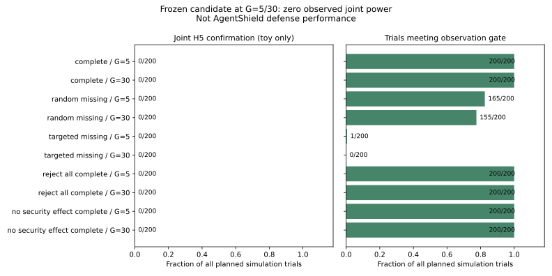

# GHO-1：完整六点联合校准结果（统计模拟）

估计器/模型/配置先于执行冻结在 `17b9047`。固定 seed161803、60家族、
5/30独立整图、每模型/图预算200试验。实际产生2,000联合试验、35,000整图
原始整数计数和2,000一次E0记录。工具执行、HTTP接收、人类标注和模型请求均为零。
结果是固定cohort条件下的假想响应模型；不是当前 AgentShield 策略的功效或防御效果。

安全AUC绑定R1六点 `[0,.05,.10,.25,.50,1]`，在[0,1]积分；
联合安全改善、全部六点TCR非劣和全部六点绝对TCR，13项使用R1的17倍校正。
配置的 `estimand` 复用安全组件的协议身份/网格绑定；联合估计对象由本模块的
13维向量定义，不把组件描述扩充为已经验证全部17项假设。

| 事先固定的假想模型 | 图数 | 同时覆盖 | 联合确认 | 观测合格 | 缺失门禁UNRUN |
|---|---:|---:|---:|---:|---:|
| 有利、完整 | 5 | 200/200 | 0/200 | 200/200 | 0/200 |
| 有利、完整 | 30 | 200/200 | 0/200 | 200/200 | 0/200 |
| 有利、3%随机缺失 | 5 | 200/200 | 0/200 | 165/200 | 35/200 |
| 有利、3%随机缺失 | 30 | 200/200 | 0/200 | 155/200 | 45/200 |
| 有利、定向MNAR缺失 | 5 | 200/200 | 0/200 | 1/200 | 199/200 |
| 有利、定向MNAR缺失 | 30 | 200/200 | 0/200 | 0/200 | 200/200 |
| 全拒绝控制 | 5 | 200/200 | 0/200 | 200/200 | 0/200 |
| 全拒绝控制 | 30 | 200/200 | 0/200 | 200/200 | 0/200 |
| 安全零效应控制 | 5 | 200/200 | 0/200 | 200/200 | 0/200 |
| 安全零效应控制 | 30 | 200/200 | 0/200 | 200/200 | 0/200 |

前三个模型的潜在真值满足H5，故0/200是这三种模型的观测联合功效；
后两种是真值不满足H5的阴性控制，0/200是观测一类错误。
分母保留所有计划试验，缺失格只从eligible中排除、不能确认。不是实际防御的HELD/FAILED。
未调整的单格二项Wilson 95%区间：0/200为[0,1.885%]，200/200为[98.115%,100%]；
这些Monte Carlo区间不用于证明跨模型/机制的覆盖保证，也不是新的任务总体置信区间。
图预算两档使用独立固定随机流；缺失计数差异不能解释为增加图数的因果效应。

结论：这个冻结候选在当前5/30图预算下**功效不可用**。全拒绝没有获胜；
零确认也不能证明真实系统安全。很宽的保守区间覆盖200/200并不构成可用性证据。
若改变估计器或图预算，须公开新方法版本、在收集pilot/保留材料前重新审核；
不按结果放宽5%/80%候选阈值，也不自动扩张预算。

独立门禁从整数计数重算[0,1]AUC、13个区间、95%观测门禁、分母与判定，
并单独重构假想模型解析真值。哈希、生成提交Git对象及当前R1参数均外部核对。
它证明保存记录与声明模型一致，不证明模型代表真实Agent或来源标注过程。
实际策略联合功效、阈值任务价值、人类真值、跨图相关、外部运行时配对继续未验证。



```sh
python -m ci.validate_source_trust_joint docs/research/source-trust-methods/r3/joint-calibration
python -m evaluation.source_trust_joint --config docs/research/source-trust-methods/r3/joint-calibration-config.json --output-dir logs/joint-rerun
python -m evaluation.source_trust_joint_plot docs/research/source-trust-methods/r3/joint-calibration/report.json.gz logs/joint-rerun.svg
```

图表仅读取已保存报告，不生成或更改试验；JSON/CSV、单次E0和原始计数均完整保留。
首次单测命令因Python包名冲突产生导入错误，保留原日志；按现有discover接口重跑。

## English interpretation

This is a full six-point **joint statistical toy calibration**, not measured policy power.
The candidate, response models and missing-data law were committed before execution.
All ten cells cover 200/200 simulated truths and confirm 0/200; the candidate is underpowered
at both tested graph budgets. MNAR trials failing the observation gate remain UNRUN.
Reject-all and no-security-effect controls are never confirmed. No pilot, holdout, annotation
or real-model execution occurred. Wide conservative intervals do not demonstrate system superiority.
