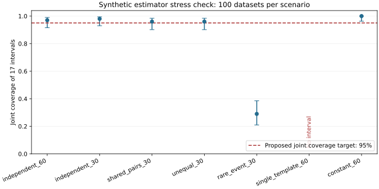

# 配对簇统计实现与合成压力检查

已实现首轮17个统计量的家族/种子等权汇总、全六点梯形AUC、整模板配对重采样和Bonferroni双侧区间。每个数据集固定10,000次、种子1729；不改变协议阈值、H5角色或正式预算。

下表是数学组件模拟，不是AgentShield任务实验。覆盖率指17个区间同时包含各自已知真值；括号为该模拟覆盖比例的95% Wilson区间，不是防御效果区间。无区间的数据集单列，不丢弃后宣称通过。

| 场景 | 家族/模板簇 | 有区间/总数 | 共同覆盖 | 诊断通过 | 退化数据集 |
|---|---:|---:|---|---:|---:|
| independent_60 | 60/60 | 100/100 | 97.0% (91.5%–99.0%) | 100 | 0 |
| independent_30 | 30/30 | 100/100 | 98.0% (93.0%–99.4%) | 100 | 0 |
| shared_pairs_30 | 60/30 | 100/100 | 96.0% (90.2%–98.4%) | 100 | 0 |
| unequal_30 | 60/30 | 100/100 | 96.0% (90.2%–98.4%) | 100 | 0 |
| rare_event_30 | 60/30 | 100/100 | 29.0% (21.0%–38.5%) | 29 | 71 |
| single_template_60 | 60/1 | 0/100 | null | 0 | 100 |
| constant_60 | 60/60 | 100/100 | 100.0% (96.3%–100.0%) | 0 | 100 |



## 解释与边界

- 估计量对家族等权；簇大小不等时每次重采样重新计算家族总数分母，不能对簇均值直接等权平均。
- 缺失指标保留[0,1]界。差值按系数正负取最坏端点，AUC沿固定六点网格传播；另报完整观测家族敏感性分析。每个相关格（含H3预执行合格子集）检查95%观测覆盖率；已知攻击送达可保留数值但不能掩盖观测失败。
- H3按家族等权、家族内合格种子等权；完全无合格种子的家族只从H3估计量排除，k=0执行记录仍保留。这是对草案未展开细节的显式实现约定，尚待冻结确认；不会按结果改权重。
- 少于30个合格簇、退化重采样或任何未定义重采样均标记失败；单模板不输出区间。常数场景即使覆盖率100%，也不能通过退化检查。
- 约14.7个bootstrap值落在每侧校正尾部。当前100个模拟数据集不足以验证95%共同覆盖、功效、MDE或尾部精度。连续组件分布不能替代真实二元任务的覆盖验证；稀有事件反例须保留，不能只报告有利场景。

## 下一步完成标准

1. 独立复核新材料及模板簇；建立验证过的执行账本→端点适配器，绑定冻结图与H3掩码，缺行/重复/跨split混入须拒绝。
2. 基于开发pilot估计方差和ICC不确定性，事前固定二元任务过程、缺失机制、更多效应/簇规模组合和模拟精度标准；再验证功效、共同覆盖和尾部种子敏感性。当前不宣称通过G09/G10。
3. 若原percentile方案在目标范围持续失效，冻结前公开方法修订及重新验证；不得为了通过而调整结果、阈值、样本数或H1–H5角色。

当前所有confirmatory_success及experiment_authorized恒为false。H5保留原数值规则用于计算核验，当前identity子集仍仅为机制范围对照，不恢复优越性主张；H4保持未选择、未实现。

复现命令（仓库根目录，输出到新目录以保留历史）：

```sh
python docs/research/source-trust/convergence/validate_statistics.py --output /tmp/agentshield-statistics-check
python -m unittest discover -s docs/research/source-trust/convergence -p 'test_paired_inference.py' -v
```
